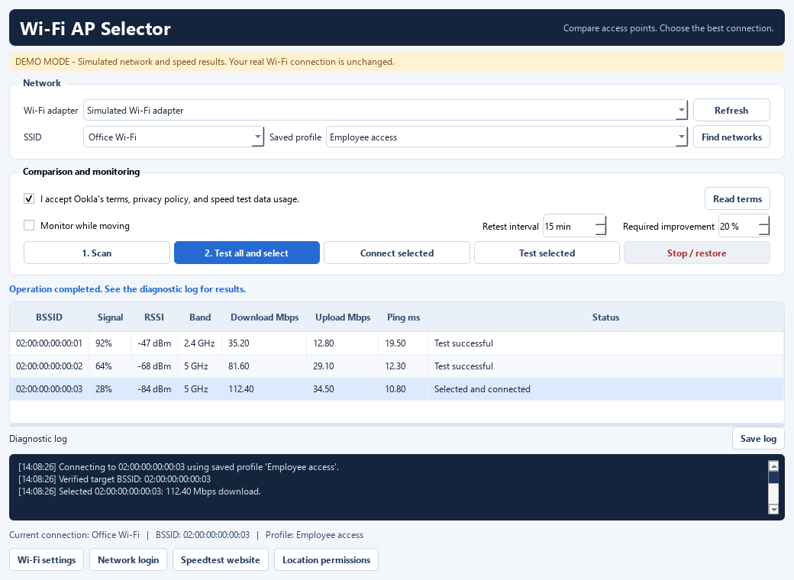

# Wi-Fi AP Selector

A Windows desktop app that finds the best access point for your Wi-Fi network by comparing real download speeds. Works with offices, universities, organizations, and home networks with multiple access points sharing an SSID.

Built with Python and Qt 6 (PySide6), with an English interface and no fixed network name.



*The screenshot shows demo data, not live measurements.*

## Features

- Discover nearby networks and list their access points, including weak signals.
- Reuse saved Windows Wi-Fi profiles, including profiles whose names differ from the SSID.
- Compare download, upload, and ping using the official Ookla Speedtest CLI.
- Connect to an individual access point or automatically select the best measured option.
- Monitor changes while moving and periodically compare access points again.
- Cancel an operation and attempt to restore the previous connection; export diagnostic logs.

## Getting started

Requires Windows 10/11 x64 and 64-bit Python 3.10 or newer. Use PowerShell in the project directory:

```powershell
python -m venv .venv
.\.venv\Scripts\python.exe -m pip install -r requirements.txt
.\.venv\Scripts\python.exe main.py
```

If you have a standalone build, open `dist/WiFiAPSelector.exe`. Python and Qt are included in that executable.

1. Connect to your network once through Windows Wi-Fi settings so Windows saves its credentials. Complete any browser login required by the organization.
2. Select your adapter and network. Use **Find networks**, choose a saved network, or enter its exact SSID. Select the matching saved profile.
3. Click **1. Scan** to list access points for that network.
4. Read and accept the Ookla terms before running speed tests.
5. Click **2. Test all and select**, or select a row to connect or test individually.
6. Optionally enable **Monitor while moving** before starting the comparison. Use **Stop / restore** to cancel.

Discovery and scanning work without a saved profile. Connecting and testing require a profile created in Windows. Speed tests use Internet data, and switching access points can briefly interrupt the connection.

## How selection works

Download speed determines the winner; lower ping breaks a tie. Each comparison uses the same Speedtest server after the first successful measurement. Results are discarded if the connection changes during a test.

If the original access point provides at least 20 Mbps, switching requires the configured improvement, which defaults to 20%. Set the improvement to 0% to select the fastest measured option regardless of that margin.

Monitoring scans about once per minute and periodically repeats the comparison (every 15 minutes by default). Changes to the access-point set or connection can trigger a comparison after a three-minute cooldown.

Wi-Fi drivers and network policies can override a requested access point. The app verifies the connected BSSID, and restoration depends on the previous network still being available.

## Demo and diagnostics

Preview the interface with simulated networks, without changing your Wi-Fi connection:

```powershell
.\.venv\Scripts\python.exe main.py --demo
```

Print adapter, profile, connection, and IPv4 information without scanning or changing the connection:

```powershell
.\.venv\Scripts\python.exe main.py --diagnose
```

## Build an executable

Create the virtual environment as described above, then run:

```powershell
.\.venv\Scripts\python.exe -m pip install -r requirements-build.txt
.\.venv\Scripts\python.exe -m PyInstaller --noconfirm --clean --onefile --windowed --name WiFiAPSelector --manifest resources/app.manifest main.py
```

The output is `dist/WiFiAPSelector.exe`. Alternatively, use `./build-python.ps1 -InstallDependencies` if your PowerShell policy allows local scripts.

The official Ookla CLI downloads over HTTPS on the first speed test and is cached under `%LOCALAPPDATA%\WiFiAPSelector`. It is not bundled in the application. Review the [Ookla EULA](https://www.speedtest.net/about/eula), [terms](https://www.speedtest.net/about/terms), and [privacy policy](https://www.speedtest.net/about/privacy).

## Troubleshooting

- **Access denied / Windows error 5:** check Windows Location services, desktop-app location access, and saved-profile permissions.
- **No adapter:** enable Wi-Fi and check the driver and WLAN AutoConfig service.
- **Missing profile:** connect through Windows Wi-Fi settings once, then click **Refresh**.
- **Tests fail after connecting:** complete the network's browser login, check Internet access, and pause VPN or other downloads.
- **Connection cannot be verified:** the driver or network may select another access point. Check the diagnostic log.

Logs and diagnostic output can contain network names, BSSIDs, and IP addresses. Review them before sharing.

## Development

```powershell
.\.venv\Scripts\python.exe -m unittest discover -s tests -v
.\.venv\Scripts\python.exe scripts/preview-qt.py
.\.venv\Scripts\python.exe scripts/verify-build.py
```

Qt tests run offscreen with simulated network data. The preview command updates `docs/screenshot.png`; build verification requires a built executable and the build dependencies.

Tests cover ranking, cancellation and restoration, network discovery, saved-profile mapping, Windows API bindings, Speedtest subprocess handling, and Qt workflows. Live roaming and throughput need testing on the target network.

| Directory | Contents |
| --- | --- |
| `duconnector/` | Application, Qt interface, Windows Wi-Fi backend, and demo backend |
| `tests/` | Automated tests |
| `scripts/` | Screenshot and executable verification tools |
| `resources/` | Windows application manifest |
| `docs/` | Application screenshot |

Virtual environments, build intermediates, executables, and generated logs are excluded from Git.
